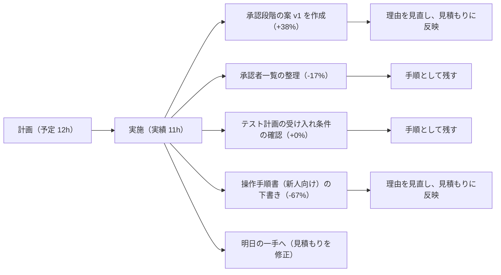

# 振り返りと学び（2026-10-24）

## 図解

## 工数（予定と実績）

| 作業 | 予定(h) | 実績(h) | 差分(h) | 差分率 | 状態 | 理由 |
|---|---|---|---|---|---|---|
| 承認段階の案 v1 を作成 | 4 | 5.5 | +1.5 | +38% | 完了 | 金額区分の条件分岐を追加したため（事実：条件が2つ増えた） |
| 承認者一覧の整理 | 3 | 2.5 | -0.5 | -17% | 完了 | 役職の一覧が既にあったため |
| テスト計画の受け入れ条件の確認 | 2 | 2 | +0 | +0% | 完了 | - |
| 操作手順書（新人向け）の下書き | 3 | 1 | -2 | -67% | 進行中 | 途中で作業を止めた。理由は要確認 |
| **合計** | **12** | **11** | **-1** | **-8%** | | |

## 学び
- 条件を増やすと、作業時間が予定より伸びやすい。見積もりに条件数を入れる。
- 既存の一覧を先に探すと、作業が短くなる。最初に確認する。
